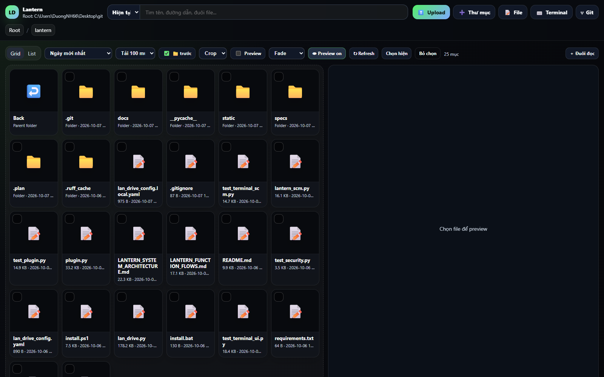
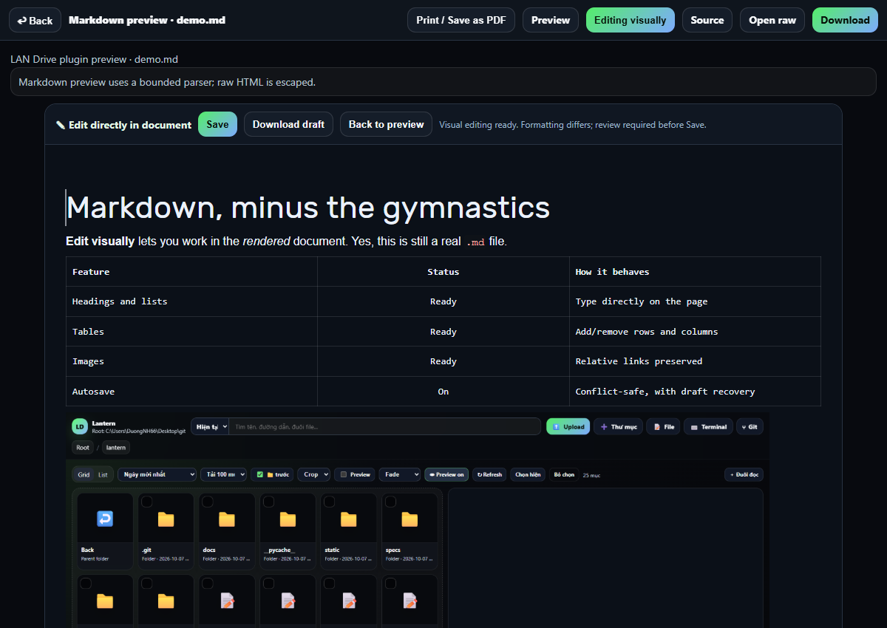
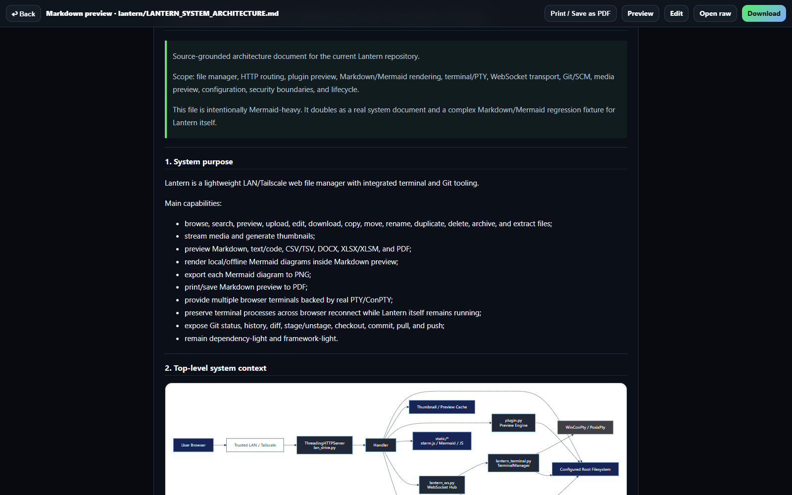
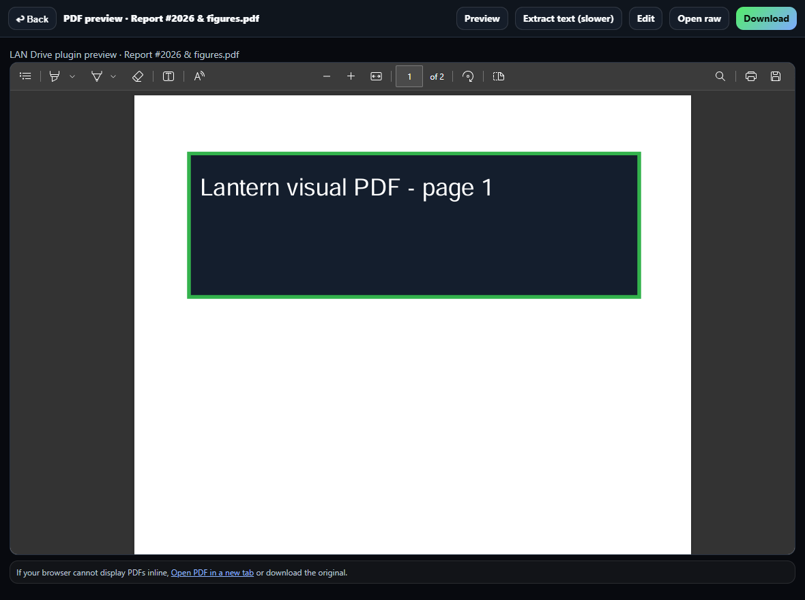
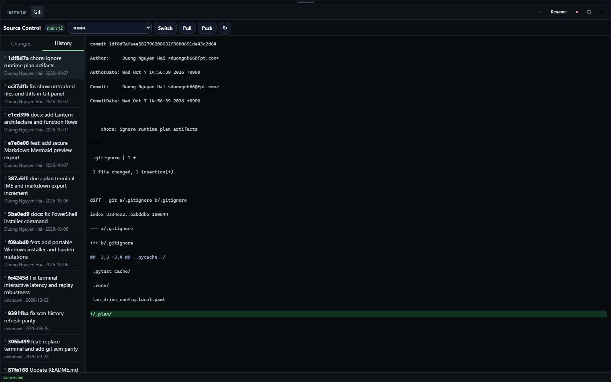
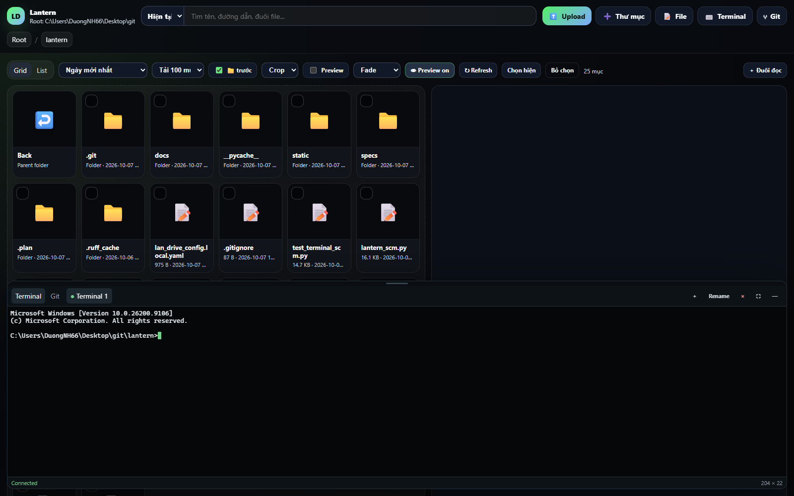

# 🏮 Lantern

**Your computer has files. Your other computer would like to meet them.**

A local-first file manager for the browser: **files, Markdown visual editing, actual PDF pages, Git, a real terminal, media, and Mermaid** — all on your own machine or a trusted LAN.

**Windows · Linux · macOS · LAN / Tailscale · No accounts · No database · No cloud upload**



> Lantern began with a modest request: *“Can I just browse that folder from another computer?”*
>
> Naturally, it now has a Git panel, a Markdown editor, a PDF viewer and a terminal. Scope creep has excellent taste.

## 🚀 Three actions. One Lantern.

**Already cloned the repo on Windows?** You do **not** need to configure Python or YAML yourself.

1. **Double-click `run.bat`.**
2. **Choose your root folder.** Press Enter for your user folder.
3. **Choose how to run it:** `1` = **Nohup** (hidden server console), `2` = **Terminal** (visible server console).

That's it. Lantern prepares Python 3.12 in `.venv`, installs its dependencies through `uv`, generates a local `lan_drive_config.yaml` from the tracked template, starts the server and opens the browser.

| Run mode | What you get | What you *don't* get |
|---|---|---|
| **1 · Nohup** | Server runs in the background, logs in `%LOCALAPPDATA%\Lantern\logs` | A permanent Windows service — signing out or rebooting ends it |
| **2 · Terminal** | Visible server console and logs | Any obligation to stare at logs for fun |

**The browser terminal is a separate feature.** Choosing Nohup does *not* disable the terminal inside Lantern. And choosing Terminal does *not* enable browser terminal access if your YAML disables it.

On first launch, the bootstrap needs internet access to download missing tools. Later launches reuse the environment. The safe default is **`http://127.0.0.1:9999`**, accessible only from the server machine until you explicitly allow LAN access.

*Yes, it really is three actions after cloning. Your future self is welcome.*

---

## ✨ Pick a mode. Pretend you only came here for one feature.

| Mode | The useful part | The less official description |
|---|---|---|
| 📁 **Files** | Browse, search, upload, edit, rename, move, duplicate, archive and download | Explorer went for a walk and found a browser |
| 📝 **Markdown Preview** | Styled documents, tables, code, relative images and task lists | Read your Markdown without looking at asterisk soup |
| ✍️ **Edit Visually** | WYSIWYG Markdown with autosave and conflict protection | *“What if the preview were also the editor?”* |
| 📄 **PDF Preview** | Real pages in the browser's native PDF viewer | PDFs have layouts. Apparently that's important |
| 🧩 **Mermaid** | Offline diagrams, PNG export and Print / PDF | Your architecture diagram doesn't need to call a CDN |
| 🌿 **Git / SCM** | Status, branches, diff, history, stage, commit, pull, push | A little branch accountability never hurt anyone |
| 🖥️ **Terminal** | Real PTY / ConPTY sessions in browser tabs | An actual shell; no textarea dressed as one |
| 🎬 **Media** | Photos, audio, video streaming, thumbnails and subtitles | Yes, the NAS now has a personality |

## ✍️ Markdown that you can actually *edit*



**Preview** is the fast, read-only starting point. The Markdown toolbar switches between **Preview / Edit visually / Source** without navigating away when nothing needs refreshing. **Edit visually** lets you type into the rendered document; **Source** edits the exact Markdown text and does not load the large visual editor bundle. Both editors share versioned saves and local draft recovery. Save the resulting **Markdown file**, not a proprietary document.

In **Preview**, GFM pipe tables are rendered (including escaped pipes and pipes inside inline code), and HTML comments stay hidden. Long tables continue as consecutive HTML table sections of at most 160 data rows each, with the column headers repeated; extra rows are **not** shown as raw Markdown. This is a Preview rendering budget, independent of the **64 KiB** threshold that enables paged **Edit visually**. Preview itself reads a bounded amount of Markdown (up to 600,000 characters) and reports when its source is truncated. In **Edit visually** and **Source**, comments and Mermaid code remain available to edit. Mermaid is rendered as a diagram **only in Preview**. HTML content such as raw `<table>` tags is escaped, not executed.

For literal Markdown punctuation, a backslash escapes formatting: `\*` displays as `*`, and `\_` displays as `_`. Underscores inside identifiers and filenames (such as `my_file_2026.md`) stay visible instead of being mistaken for italics. **Preview** hides valid HTML comments (`<!-- ... -->`); malformed `!<-- ... -->` text is not a comment and remains visible. **Edit visually** keeps comments available for editing.

A few things that matter outside a demo:

- **Tables:** add or remove rows and columns in the visual editor.
- **Images:** display existing relative Markdown images without changing source links. **Ctrl+V** a screenshot from Paint or paste/drop a supported image: Lantern uploads it to the document's nearby `assets/` folder and inserts a real relative link. No temporary `blob:` links in your saved Markdown.
- **Shared image Crop:** in **Edit visually**, click a PNG/JPEG/WebP/BMP image → **Crop image**; or open a picture in Lantern's full image viewer → **✂ Crop**. Resize using the **four corner handles**, drag the selection to move, use **+/−** to zoom, then **Apply crop**. Visual Edit writes a new asset to the document's `assets/` and updates the Markdown link using existing versioned saves; the image viewer uses **Save As** into the same folder, never overwriting the original. A side-preview image has an **Open / Crop** action to reach the full viewer. **Delete image** (or the editor's Delete key) only removes the Markdown reference. Static JPEG exports as JPEG; PNG as PNG; static WebP as WebP when supported (alpha-bearing WebP exports as PNG); BMP as PNG. Canvas-based output does not preserve EXIF/ICC metadata or guarantee lossless JPEG recompression. GIF, animated PNG/WebP, SVG and cross-origin images are not supported. Unsupported/oversized formats fail without uploading; source assets are never deleted.
- **Autosave:** saves edits after idle without blocking the entire page.
- **Two people, one file:** content-hash checks reject stale writes (HTTP 409) rather than silently overwriting the other person's work.
- **Draft recovery:** unsaved edits are kept locally while editing and can be recovered after an unexpected browser close. **Preview** asks for confirmation before discarding unsaved edits; confirming clears the browser draft instead of bringing old content back. Cancel keeps the editor and edits open. A downloadable emergency copy remains available.
- **Formatting safety:** if opening a file would rewrite its Markdown syntax, Lantern requires a before/after review before saving.
- **Large documents:** full-document visual editing up to 64 KiB; larger UTF-8 documents up to **5 MiB** use lossless, section-based navigation. Source mode can edit the whole document up to the same 5 MiB limit. Switching from Source to Visual on a large file enters the paged editor (save pending Source edits first). Switching back from a paged section to Source also requires saving that section, so unsaved edits cannot silently disappear. Very large code fences use a localized CodeMirror pane.

The visual editor lazy-loads its offline Milkdown/ProseMirror bundle only when requested. A big document does not need to summon an entire editor just because you wanted to read a heading.

> Files named `final_final_REAL_final_v9.md` are fully supported. No questions asked.

### 🧩 Mermaid, still living entirely on your computer



Write fenced `mermaid` blocks for flowcharts, sequence diagrams or state diagrams. Lantern loads the locally vendored Mermaid runtime **only when a document contains a diagram**.

You can export individual diagrams as **PNG** or use **Print / Save as PDF** for the Markdown preview via your browser's print workflow. Markdown editing and Mermaid rendering are separate features: you are not forced to use the editor to view a diagram.

If the diagram needs 14 boxes to explain one `if` statement, the renderer will cooperate. Your reviewer may not.

## 📄 PDF preview that shows the **PDF**, not just its text



Opening a `.pdf` now displays **real pages**, including their visual layout, using the browser's PDF viewer. On a supported browser you get page navigation, zoom, scrolling and the browser's own PDF controls.

The existing file server supports **HTTP byte ranges**. Lantern opens the lightweight viewer shell without waiting for a server-side PDF text parser to finish.

Need plain text instead? Click **Extract text (slower)**. That uses `pdftotext` if available, or a bounded fallback, and only targets an initial portion of the file. It is optional — **not** the prerequisite for looking at page one.

If your browser lacks inline PDF support, use **Open raw** or **Download**.

> Old PDF workflow: “Please wait while I interpret your document's existential meaning.”
>
> New PDF workflow: “Here are the pages.”

Other document previews are deliberately different: **DOCX** and **XLSX/XLSM** use bounded, lightweight content previews, **not** a full-fidelity Microsoft Office renderer. They do not promise exact fonts, formula evaluation or print layout.

## 📁 Files, without the USB-stick diplomacy

Grid or list view, breadcrumbs, search, sorting, lazy loading, thumbnails, multi-file uploads, create/rename/copy/move/delete, ZIP/archive tools, file downloads and shared links.

Images open as images. Videos stream with seeking and HTTP Range support. Subtitles and thumbnails are supported, with richer media metadata available when `ffmpeg` / `ffprobe` are installed.

One server can serve multiple browser clients. You don't have to install Lantern on every PC just to browse the server from that PC.

## 🌿 Git and a real shell — together, but not mysteriously



Git reads happen in the SCM panel: working-tree changes, stage/unstage, diffs, branch tracking, untracked files and commit history.

Git writes — including **commit, checkout, pull and push** — use a **visible terminal session** so you can see the command and its result.



The browser terminal uses **xterm.js + WebSocket + real PTY** on Linux/macOS, or **ConPTY via pywinpty** on Windows. It supports multiple sessions, resize, rename, bounded output history and reconnecting a browser tab.

Windows defaults to **PowerShell** (falling back to CMD). Git Bash is optional via `LANTERN_SHELL` or `PI_WEB_SHELL`, because MSYS2's “`fork: Resource temporarily unavailable`” is not a feature anyone requested.

Handy keys: **Ctrl + backtick** toggles the drawer; `Alt+Enter` toggles fullscreen; `Ctrl+C` copies a selection or sends interrupt; `Ctrl+V` pastes.

Closing a browser tab does not by itself kill a server-hosted terminal. **Stopping Lantern does.** It is persistent across browser reconnects, not immortal.

---

## 🌐 Using it from another computer

By default Lantern binds to `127.0.0.1` for safety. On a **trusted** LAN or Tailscale network, explicitly choose a reachable interface in your ignored YAML:

```yaml
root: "D:/Share"
host: "0.0.0.0"   # Only on a trusted network
port: 9999
terminal_enabled: false
```

Restart Lantern, then open `http://SERVER-LAN-IP:9999` from another device (or your machine's Tailscale IP). **Do not** enter `0.0.0.0` in the browser address bar.

*Clients need a browser. The server needs Python and its dependencies.* With several separate Lantern servers, each owns its own terminals, preview limits and cache; sharing a folder over the network does not turn them into a distributed transaction system.

### 🔐 Security: the joke ends here

Lantern does **not** require login for file browsing/editing within its configured root. **Terminal password protection is optional and OFF by default**: when no password is configured, localhost, LAN and Tailscale clients can all use Terminal. With a password enabled, only localhost bypasses it by default; remote Terminal commands, metadata and output are protected server-side. Git/SCM browsing remains available, but Git actions that run shell commands require Terminal unlock when protection is enabled.

**Warning:** without Terminal password protection, anyone who can reach Lantern can run commands with the server user's OS privileges. Bind only to trusted networks.

### 🔑 Optional Terminal password (set or clear on the host)

Terminal is passwordless unless a password hash has been configured. These YAML forms are equivalent:

```yaml
# Default: omit terminal_password_hash entirely, or use either value:
terminal_password_hash: ""
# terminal_password_hash: no-password
```

You do **not** need to run `--set-terminal-password` unless you want to enable authentication. Omitting the command on a later start does **not** remove an existing password.

**Per-process override (`--no-password`):** If the YAML already contains a password hash, `--no-password` disables Terminal authentication **only for that launched Lantern process and its port**. The saved hash is unchanged; a second server without the flag still requires the password. For example, run these as separate processes:

```powershell
# Port 9999: enforces the saved YAML password (when one is set)
python lan_drive.py --config lan_drive_config.yaml --host 0.0.0.0 --port 9999

# Port 9998: no Terminal password, despite using the same YAML
python lan_drive.py --config lan_drive_config.yaml --host 0.0.0.0 --port 9998 --no-password
```

The difference is deliberate: `terminal_password_hash: no-password` (or empty/absent hash) disables password protection for **every** process reading that YAML, whereas the `--no-password` flag overrides the hash for **one running process only**. It does not persist in YAML and it cannot be combined with `--set-terminal-password`. Only expose a passwordless LAN port to trusted users.

To enable protection or clear an existing password in the YAML, run this command locally from your Lantern checkout:

```powershell
python lan_drive.py --set-terminal-password --config lan_drive_config.yaml
```

For the separate Windows installer (`install.bat` / `install.ps1`), the actual config is `%LOCALAPPDATA%\Lantern\lan_drive_config.local.yaml`. Use this PowerShell command instead:

```powershell
$lantern = Join-Path $env:LOCALAPPDATA 'Lantern'
& "$lantern\.venv\Scripts\python.exe" "$lantern\app\lan_drive.py" --config "$lantern\lan_drive_config.local.yaml" --set-terminal-password
```

Enter a password of at least 12 characters twice **locally** to enable protection. Lantern stores a salted PBKDF2 hash, never the plaintext password. To **disable** an existing password, run the same command and press Enter twice at the password prompts, or set `terminal_password_hash: ""` / `terminal_password_hash: no-password` in the local YAML. **Restart Lantern to apply changes**; restart also invalidates existing Terminal login sessions. There is no remote password-setting API. A malformed hash (other than the explicit passwordless values) stays locked instead of opening access.

**Only when a password is configured**, remote visitors open **Terminal → enter password → Unlock Terminal**. After login, their browser receives an `HttpOnly`, `SameSite=Strict` session cookie valid for up to 8 hours, bound to its source IP; **Lock Terminal** revokes the session. Five failed attempts from one IP impose a five-minute cooldown. In passwordless mode, no login form or session is required.

**When password protection is enabled**, `terminal_local_bypass: true` permits actual loopback clients (`127.0.0.1` / `::1`) without a password; `Host` and `X-Forwarded-For` headers do not grant access. Reverse proxies forwarding through loopback may obscure real clients; configure `terminal_local_bypass: false` in that setup (then localhost must also log in). This setting does **not** enable authentication when the password hash is empty or `no-password`. The YAML is blocked from Lantern's file operations; avoid exposing its backups or letting untrusted users change server code.

**Encryption matters:** Tailscale connections benefit from WireGuard transport encryption. Ordinary HTTP over LAN transmits passwords/session cookies without browser-level TLS protection; put HTTPS in front of Lantern before sharing Terminal credentials on an untrusted LAN. Terminal-only authentication is **not** whole-app security: editable scripts, Git config/hooks and other execution-capable files within the shared root can remain dangerous.

Use the smallest useful root, restrict firewall rules, avoid Administrator/root, prefer loopback or private Tailscale, and **never expose Lantern directly to the public internet** without an authenticated front end.

The Markdown preview applies HTML escaping, same-origin checks, nonce-based script CSP and path/URL confinement. Stronger isolation for uploaded HTML/SVG and iframe preview content remains a security hardening item. Do not treat an unpublished port number as authentication.

---

## 🛠️ Other ways to install and run

### Windows: installer instead of Git clone

If you don't want to manage a clone, `install.bat` (or `install.ps1`) can install an independent copy into `%LOCALAPPDATA%\Lantern`, prepare Python 3.12 and dependencies, and generate its own local config.

```powershell
.\install.bat -Root "D:\Share"
# To enable browser terminal explicitly:
.\install.bat -Root "D:\Share" -EnableTerminal
# Bind to every interface only on a trusted LAN:
.\install.bat -Root "D:\Share" -BindAll
```

The installer defaults to **127.0.0.1**, port **9999**, and **browser terminal disabled**. Its generated launcher lives at `%LOCALAPPDATA%\Lantern\Run-Lantern.bat`.

### Linux / macOS

```bash
python3 -m pip install -r requirements.txt
python3 lan_drive.py --root "$HOME" --host 127.0.0.1 --port 9999
```

Or manage the Python environment with `uv`. The browser-side editor, terminal UI and Mermaid resources are vendored — **Node and CDN access are not needed at runtime**.

### Configuration and existing clones

Git tracks **`lan_drive_config.yaml_copy`**, not your machine's real `lan_drive_config.yaml` or `lan_drive_config.local.yaml`. Those local config files are ignored, so new clones can use the template and existing users can keep their paths and settings.

Manual setup:

```powershell
Copy-Item lan_drive_config.yaml_copy lan_drive_config.yaml
uv run --with-requirements requirements.txt python lan_drive.py --config lan_drive_config.yaml
```

**Updating an old clone with a modified, previously tracked YAML?** A normal `git pull` can conflict during the one-time transition to `.yaml_copy`. Use the safe fast-forward updater **before** pulling. It backs up the original bytes privately and restores the local YAML:

```powershell
$helper = Join-Path $env:TEMP 'lantern-safe-pull.py'
Invoke-WebRequest -UseBasicParsing 'https://raw.githubusercontent.com/Hiroshimeow/lantern/main/tools/safe_pull.py' -OutFile $helper
uv run --no-project python $helper --repo (Get-Location).Path
```

Run it from your Lantern checkout root. It refuses staged config changes rather than discarding them. After migration, normal `git pull --ff-only` is sufficient.

CLI overrides: `--root`, `--host`, `--port`, `--config`, `--title`, `--cache-dir`, `--sort`, `--view`, `--page-limit` and `--save-config`. Use `python lan_drive.py --help` for the authoritative list. CLI overrides are runtime-only unless explicitly saved.

---

## 🧪 For people who read test output voluntarily

```powershell
uv run --with-requirements requirements.txt python -m unittest -q
node --test tests/test_md_segmentation.mjs
```

Browser E2E tests are opt-in, run against disposable loopback servers, and do not need to restart your live Lantern instance:

```powershell
$env:LANTERN_E2E = "1"
uv run --with-requirements requirements.txt --with playwright python -m unittest -v tests.test_md_visual_e2e tests.test_md_paged_e2e tests.test_pdf_browser_e2e
```

Tests cover preview/XSS/CSP boundaries, PDF streaming, Markdown round-trips, save conflicts, large-file paging, terminal lifecycle, Git parsing, and LAN list/refresh behavior.

Main source map:

```text
lan_drive.py                HTTP server, filesystem, media, config
plugin.py                   Document preview, Markdown, native PDF shell
lantern/                    Internal Python runtime package
  md_editor.py              Markdown save/version/draft contracts
  terminal.py               PTY / Windows ConPTY
  terminal_auth.py          Optional remote Terminal authentication
  ws.py                     WebSocket transport
  scm.py                    Git/SCM service
static/                     Browser frontend + offline vendor bundles
tools/                      Build and safe migration scripts
tests/                      Unit / integration / Edge browser E2E
docs/architecture/          System diagrams and function flows
docs/images/                Actual Lantern UI screenshots
run.bat                     Three-action Windows launcher
lan_drive_config.yaml_copy  Git-tracked configuration template
```

Want diagrams? We have diagrams about our diagrams:
[System architecture](docs/architecture/LANTERN_SYSTEM_ARCHITECTURE.md) and
[detailed function flows](docs/architecture/LANTERN_FUNCTION_FLOWS.md), with **44 Mermaid diagrams** in total.

Only rebuild the vendored visual Markdown assets when changing frontend build dependencies: `npm ci && npm run build:markdown`. This is a developer step, not a user installation requirement.

## Boundaries worth knowing

- The visual editor has a deliberate **5 MiB** maximum; read-only previews remain available separately.
- In Visual Edit, paste/drop PNG, JPEG, WebP, GIF or BMP images (up to 20 MiB each). Lantern saves each file in an adjacent `assets/` folder before inserting a durable relative Markdown link; unsupported clipboard formats are not uploaded.
- DOCX/Excel previews are bounded content views, not Word/Excel clones.
- Browser PDF rendering depends on PDF support in the browser; direct-open/download fallbacks exist.
- Browser print-to-PDF for Markdown uses the browser's print engine.
- File Browser remains unauthenticated within the configured root; remote Terminal password protection is **opt-in**, stored in the local YAML. No promise of surviving a server restart with terminal sessions, and no public-internet security guarantee.
- There is currently **no license file**; normal copyright restrictions apply until one is added.

---

> **Lantern** — because sometimes the best distributed filesystem architecture is *“the other computer is literally right there.”*
