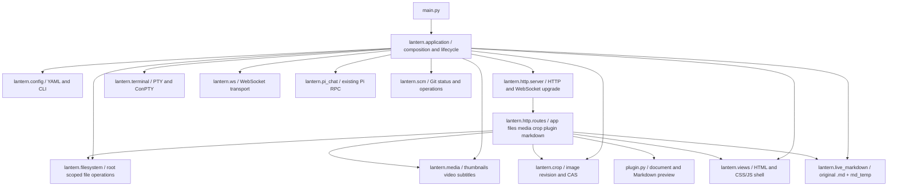

# Lantern — Current application architecture

Canonical post-refactor module owners. This document supersedes the old one-file module maps in LANTERN_SYSTEM_ARCHITECTURE.md and LANTERN_FUNCTION_FLOWS.md; their older diagrams remain historical references.

## Invariants

- `main.py` is the **only** executable entrypoint. `lan_drive.py` is removed; no compatibility module remains.
- `Application` owns server-scoped state, shutdown and teardown; WebSocketHub, TerminalManager, LanternBotManager, ScmService, LiveMarkdownStore, CropService and heavy Preview semaphore are **per-instance**.
- HTTP handlers and routes access `self.server.app` and call the associated service, never mutable module globals.
- Domain file/media/crop services do not own HTTP sockets or import `main.py`; route methods are responsible for status/header serialization.
- File manager HTML/CSS/JS output and API formats are unchanged. No UI redesign or feature/security changes are included.
- Original `.md` is written directly; `md_temp` is the comparison checkpoint accepted with Ctrl+S. Pi edits are observable as ordinary file changes.
- Root and config are explicit per app. The old process-global `os.chdir` is removed, allowing two servers in one Python process without cross-root interference.
- Launcher/installer/scripts and tests point to the new canonical entrypoint. Existing machine YAML format is retained.

## Verification baseline

- Frozen legacy HTTP oracle: `tests/fixtures/foundation_http_oracle.json` from the prior single-file release.
- `tests/test_app_http_contract.py` verifies 15 HTTP/API/Range/Markdown outcomes with a disposable server/root.
- `tests/test_app_architecture.py` verifies two independent app instances, service lifecycle and single entrypoint.
- Full pre-refactor suite: 202 PASS / 108 SKIP / 21 subtests. New suite and browser evidence must be compared before merging.

## Work ownership

- `main`: platform and Markdown/Preview/Edit/Crop.
- `.wt/lantern-bot`: separate Pi-native TUI feature, rebased on latest `main` before development and merging.
- The current Pi RPC behavior is preserved only as the *current* product, not a compatibility layer for future TUI; the TUI replacement is governed by `specs/004-pi-native-harness`.
- Security/LAN quotas, new Crop UX, Markdown parser modifications and native Pi TUI are outside this structural refactor.
