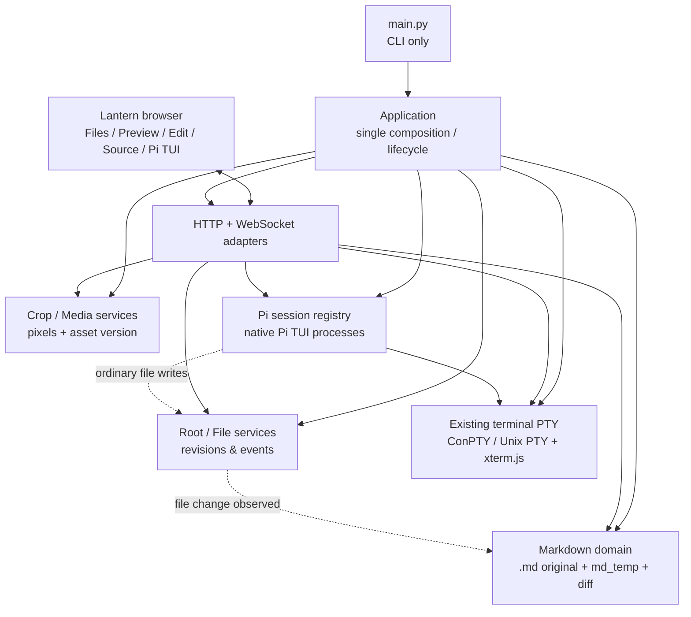
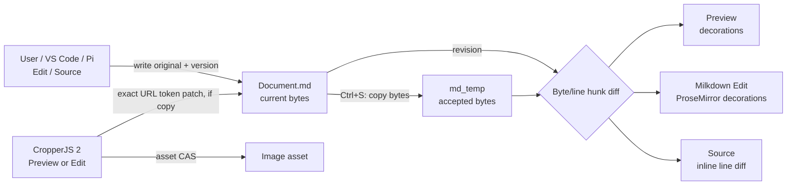
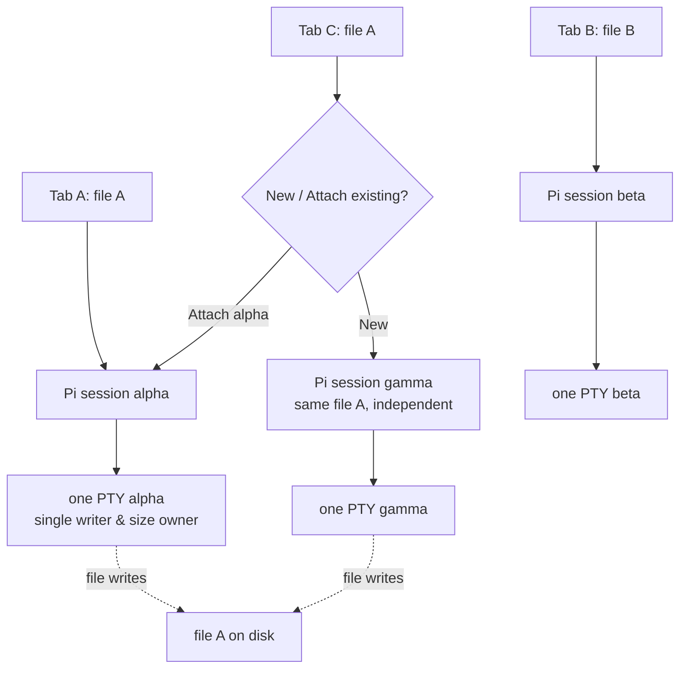

# Lantern — Đề xuất kiến trúc cho người duyệt (17/10/2026)

**TÌNH TRẠNG: DỰ THẢO — CHƯA ĐƯỢC PHÉP IMPLEMENT.** Kết quả 3 vòng tranh luận độc lập với Sonnet M365 trên FJP; đồng thuận về kiến trúc/tiêu chí, chưa có bằng chứng cho các kỹ thuật cần thử.

**Tài liệu:** [upstream verification](upstream-verification.md) · [constitution](constitution.md) · [foundation spec](spec.md) · [foundation plan](plan.md) · [foundation tasks](tasks.md) · [Markdown spec](../003-markdown-fidelity/spec.md) · [Markdown plan](../003-markdown-fidelity/plan.md) · [Markdown tasks](../003-markdown-fidelity/tasks.md) · [Pi spec](../004-pi-native-harness/spec.md) · [Pi plan](../004-pi-native-harness/plan.md) · [Pi tasks](../004-pi-native-harness/tasks.md) · [Decision record](decisions.md) · [Requirements matrix](analysis.md).

## Tại sao cần kiến trúc này?
- Cùng một file .md có thể sửa từ Edit, Source, VS Code, Pi mà không mất nội dung. .md_temp chỉ là ảnh chụp so sánh, Ctrl+S chấp nhận diff.
- Pi chạy đúng native interactive TUI: command /, extension, skill, provider, /goal và custom UI. Không tạo một chat renderer RPC riêng phải đuổi theo Pi upstream.
- Mỗi Pi session có id bền vững riêng, không phụ thuộc tab, path hay browser WS. Hai phiên có thể cùng gắn một file nhưng không thao tác nhầm nhau.
- Module theo trách nhiệm, baseline parity trước refactor, không nợ kỹ thuật do wrapper/migration vĩnh viễn.

## Architecture / module ownership

**Giới hạn:** Markdown và Pi không import nhau. HTTP adapter không giữ nội dung hoặc phiên. Không tạo event bus/policy engine mới khi chưa có consumer. Security/LAN nâng cấp cần phê duyệt riêng.

## Luồng Markdown — file gốc & snapshot

Không có ghi tự động vào md_temp. Undo sau Save được xem là một edit mới. Không dùng vị trí được đoán hoặc normalize nội dung ngoài vùng sửa.

## Hai tab Pi độc lập và cùng một phiên

Đóng tab hoặc F5 không giết phiên đang chạy; server restart có thể mở lại lịch sử Pi, **không** được giả lượt đang chạy vẫn tiếp tục nếu process đã dừng. Trạng thái idle/cleanup do người dùng quyết định.

## Gói Spec-Kit độc lập
| Gói | Phạm vi | Phụ thuộc | Triển khai |
|---|---|---|---|
| **002 — Foundation** | main.py, composition, modules, HTTP/WS parity, installers | Baseline fb06c40 + ký duyệt | Worktree riêng → atomic cutover, merge main sau gate |
| **003 — Markdown Fidelity** | Original/md_temp, Diff ba chế độ, Crop ảnh nhúng, byte preservation | 002 đạt nghiệm thu | main (owner của Markdown) |
| **004 — Native Pi Harness** | interactive Pi TUI, session registry, xterm replay, multi-tab | 002 đạt nghiệm thu | feat/lantern-bot, rebase trước dev và trước merge |

003 và 004 có thể làm **song song sau 002** vì không cùng sửa một owner. Test / review theo package, không khóa merge chỉ vì độ đơn giản hay thời gian.

## Trạng thái / bằng chứng
| Nhận định | Mức chứng minh |
|---|---|
| Main HEAD fb06c40; 9999 hiện chạy bản commit cũ | Đã kiểm FJP |
| Main có uncommitted refactor dở; không đủ gate để merge | Đã kiểm FJP |
| Milkdown Edit có mountImageCrop và DecorationSet | Đã đọc source, chưa nghiệm thu đủ UX |
| Preview Crop chưa ngang bằng Edit, Source/Visual diff còn lỗi reported | Có báo cáo người dùng, cần E2E tái hiện |
| Pi TUI native đủ tốt dưới ConPTY + reconnect/replay | **Chưa chứng minh — proof spike** |
| Milkdown giữ byte ngoài vùng sửa bằng patch đúng | **Chưa chứng minh — proof spike** |
| 3 vòng tranh luận Sonnet đồng ý baseline và gate | Đã lấy phản hồi M365 thực tế, xem decisions.md |

## Yêu cầu phê duyệt
Chấp thuận **thiết kế và các proof-spike sau khi phê duyệt**, không có nghĩa chấp nhận kết quả chưa đo. Không cho phép thay Milkdown bằng Visual chỉ đọc hoặc hạ chuẩn nhập liệu nếu không được phê duyệt riêng. Không cài bảo mật mới.
