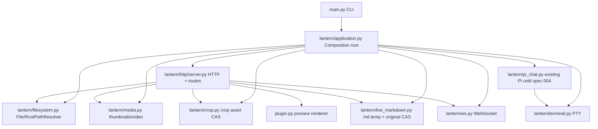

# Implementation Plan: Lantern Platform Foundation (DRAFT)
**Branch triển khai dự kiến:** refactor/lantern-platform (TẠO SAU KHI DUYỆT)
**Spec:** specs/002-lantern-foundation/spec.md
**Hiến chương:** specs/002-lantern-foundation/constitution.md
**Baseline:** fb06c40. KHÔNG thực thi kế hoạch khi chưa duyệt.

## Summary
Chuyển sang main.py duy nhất bằng **một lần cutover dứt điểm**, không phát hành trạng thái trung gian hay wrapper tương thích. Trong worktree refactor riêng, trích xuất theo trách nhiệm và chạy baseline characterization không thay expected sau từng checkpoint. Tất cả module được import không có side effect; composition root duy nhất tạo service có trạng thái.

## Technical Context
- Python 3.12+, HTTP hiện dùng thư viện chuẩn, YAML/Pillow/pywinpty, JS frontend.
- Windows FJP/Edge là môi trường nghiệm thu chính; Linux smoke riêng.
- Trạng thái ứng dụng không đặt module global; metadata giữ ở config và session managers có lifecycle.
- HTML/CSS/HTTP headers phải được snapshot trước khi di chuyển, tránh thay URL/cache/content-type tùy tiện.
- Không cài package, thay parser/renderer, hoặc đổi giao thức chỉ vì refactor.
- Không triển khai security mới; localhost vẫn là môi trường chính.

## Constitution Check
- Không có mã sản phẩm hay phụ thuộc mới trước duyệt.
- Một nơi sở hữu resource; test gốc không được sửa golden/đổi kỳ vọng để hợp thức hóa thay đổi.
- Không hạ cấp terminal/Pi/Markdown/render/file manager/Crop.
- Không cấu hình thêm behavior đặc quyền trên LAN.
- Phải đo E2E, latency, memory và xử lý 2 instance song song.

## Architecture (đề xuất)

Các dependency thực tế truyền qua constructor/đối số cụ thể (từng route chỉ nhận service mình dùng), không có 'app everything' ẩn vai trò. Không tạo EventBus/PolicyGate có 0 consumer; chỉ tài liệu contract về sự kiện khi có chức năng thật.

## Source Ownership / Exact target files (đề xuất)
| File | Owner | Boundary |
|---|---|---|
| main.py | CLI entrypoint | parse args + gọi run(app); không chứa business logic |
| lantern/application.py | lifecycle | composition, startup/shutdown, graceful close |
| lantern/config.py | cấu hình | AppConfig, YAML load/save validation; không import server |
| lantern/filesystem.py | file & root | PathResolver, list/copy/move/delete, CAS helper |
| lantern/media.py | media | thumbnail, video info, subtitle; nhận root và cache explicitly |
| lantern/crop.py | asset lifecycle | mime/version, crop overwrite; không import Markdown editor |
| lantern/http/server.py | HTTP adapter | parse/request/response/route dispatch, HTTP state |
| lantern/http/routes/files.py | file operations adapter | chỉ dùng FileService |
| lantern/http/routes/markdown.py | Markdown adapter | chỉ dùng LiveMarkdownStore/preview |
| lantern/http/routes/media.py | asset adapter | chỉ dùng Media/Crop |
| lantern/http/routes/app.py | app/config endpoints | cấu hình, info/status |
| plugin.py | Preview renderer | giữ API hiện hành và test độc lập |
| lantern/live_markdown.py | Markdown data | giữ hiện trạng đến feature 003; không phụ thuộc Pi |
| lantern/terminal.py, lantern/ws.py, lantern/scm.py | runtime hiện tại | preserve behavior, chỉ inject lifecycle |
| static/* | browser frontend | giữ nguyên API/assets; không chỉnh UI trong refactor |

Chỉ tạo module khi thực sự có responsibility/được test; không chẻ nhỏ thêm vì số dòng. Nếu module mới không có owner độc lập, gộp lại.

## Contract prototypes (để task sử dụng; có thể điều chỉnh khi kiểm chứng)
- PathResolver(root).resolve(relative_path) -> Path | PathError
- FileService(root_resolver, config).list/read/mutate(...) -> typed result; không gọi HTTP trực tiếp
- Revision(content_sha256, stat) dùng trong ghi CAS theo spec Markdown.
- Application(config, services).start()/close(); close idempotent, 2 instances không chia sẻ registry.
- HttpRoutes(handler primitives, owned services) -> response object; không có module globals hay singleton.
- TerminalManager và WebSocketHub giữ interfaces hiện tại cho tới khi characterization chứng minh refactor cần thay.

## Phase 0: Nghiên cứu/baseline bất biến
1. Chụp HTTP method/URL/query/status/header/body và WS sequence từ checkout sạch fb06c40, ephemeral port/root, không ghi lên main đang bẩn. Kê danh sách fields biến động cần masking và review từng mask.
2. Lập bảng import graph và startup lifecycle; chụp benchmark 3 tình huống.
3. Kiểm kê WIP chưa commit ở main (AST split), ghi từng file và failure, để người dùng quyết định giữ làm tài liệu hay cách xử lý; không tự reset/stash/clean.

## Phase 1: Module extraction trên branch implementation riêng
4. Tạo internal worktree từ HEAD clean sau duyệt; rebase main trước khi làm.
5. Tách config/path/file/media theo owner; mỗi bước có test mới và chạy characterization cũ; tuyệt đối không bản copy hoạt động song song.
6. Tách HTTP routes và composition; sửa import direction; không đổi endpoint/headers.
7. Hợp đồng 2 instance và graceful shutdown, ngăn double initialization.

## Phase 2: Cutover nguyên tử
8. Đổi launcher, installer, tests, README sang main.py; xóa lan_drive.py cùng commit cutover, không wrapper/alias/entrypoint thứ hai.
9. Khởi động/browse/terminal từ checkout mới trên cổng thử, không đụng 9999/10099 khi chưa duyệt.

## Phase 3: Nghiệm thu/handoff
10. Chạy golden HTTP/WS, Python, Playwright/Edge, Pi/terminal smoke, Linux smoke; đo bench cùng máy.
11. Reviewer độc lập kiểm tra API parity, import graph, cấu hình, dữ liệu, WIP không mất; baseline difference log có từng thay đổi được ký duyệt.
12. Rebase main + test lại + ff merge/push chỉ sau chủ sở hữu cho phép.

## Go/No-go
- Không có characterization baseline -> STOP.
- Golden contract bị thay chỉ vì code mới -> STOP.
- Unintended normalized Markdown, mất history/Terminal/WS hoặc mất file người dùng -> STOP.
- Main WIP không được xử lý minh bạch -> STOP.
- Thiếu xác nhận của người dùng -> STOP, không triển khai.

## Open decisions
- Cách lưu và xử lý WIP không commit trên main; không làm ở đợt spec.
- Ngân sách benchmark p95/RSS chính xác và có cần giữ 2 cổng runtime hoạt động song song lúc review.
