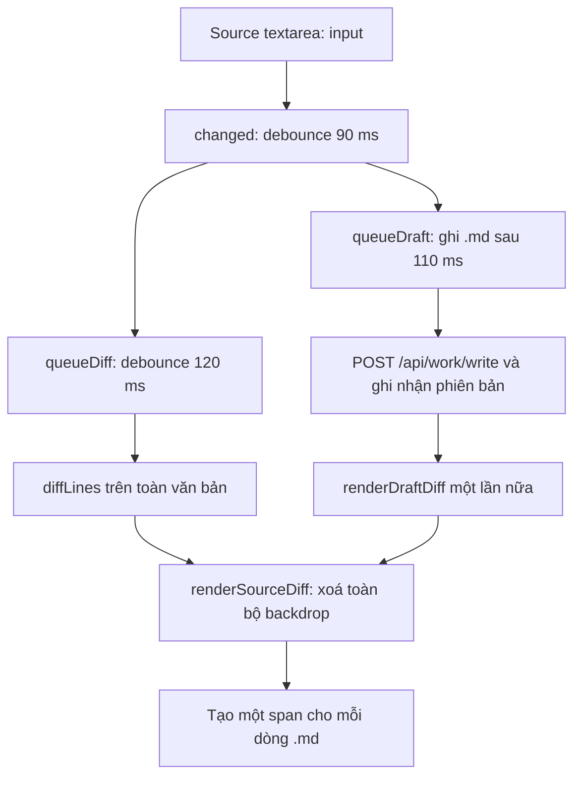

# Source Editor — UX và hiệu năng (đối chứng trước/sau refactor)

**Ngày:** 2026-10-17 · **Loại:** kiểm toán / bằng chứng cho feature 003 · **Trạng thái:** lỗi tồn đọng, KHÔNG phải hồi quy được xác nhận từ refactor 002.

## Kết luận từ thực nghiệm

Đối chiếu `1b5939357bfd3748a1c56b5e491bc55026b0368b` (trước refactor) với `cbc928631d7c1703107bcb076657a4596e80f15d` (sau refactor), trên Windows G6 / Edge headless, cùng dữ liệu thử và các thao tác bàn phím, hai server localhost ở **cổng ngẫu nhiên**, không chạm dịch vụ cổng 9999.

Git blob SHA của `static/markdown_visual_shell.js`, `.css`, `markdown_paged_editor.js`, `markdown_draft_diff.js`, `chatbot.js` và `chatbot.css` **trùng tuyệt đối** giữa hai bản. Backend được kiểm tra qua thao tác ghi file của trình duyệt thật, không chỉ suy đoán theo diff Git.

| Tình huống | Pre-refactor | Current main |
|---|---:|---:|
| 900 dòng: thời gian gõ trung vị (9 phím) | 9,80 ms | 8,50 ms |
| 900 dòng: p95 thời gian gõ | 18,04 ms | 9,61 ms |
| 5.500 dòng: thời gian gõ trung vị | 72,90 ms | 70,24 ms |
| 5.500 dòng: p95 thời gian gõ | 144,94 ms | 132,63 ms |
| 5.500 dòng: số DOM node thêm vào lớp diff (9 phím) | 99.054 | 99.054 |
| 5.500 dòng: lượt mutation trên lớp diff | 18 | 18 |
| 5.500 dòng: POST ghi file .md (9 phím, khoảng ngừng 330 ms) | 9 | 9 |
| 5.500 dòng: GET trạng thái file | 4 | 4 |
| Số lần điều hướng chính, kể cả lúc mở trang | 1 | 1 |
| Lỗi JavaScript | 0 | 0 |

**Giới hạn bằng chứng:** mỗi cấu hình chạy một lượt 9 phím; giá trị p95 có tính mô tả, chưa đủ làm phân tích thống kê tổng quát. Tuy nhiên, hành vi tạo lại 99.054 DOM node, số lượt ghi file, số lần điều hướng và mã frontend **giống nhau** là bằng chứng mạnh rằng nguyên nhân lag vốn có. Không được kết luận tuyệt đối rằng mọi cấu hình backend đều không hồi quy.

## Nguyên nhân xác minh theo luồng dữ liệu

- `static/markdown_visual_shell.js::renderSourceDiff` xoá toàn bộ `sourceBackdrop.textContent` rồi dựng lại một `span` cho **mọi dòng**, thay vì cập nhật vùng đang nhìn hoặc các đoạn thay đổi.
- `changed`, `queueDiff` và `queueDraft` kích hoạt xử lý lặp. ACK sau ghi file cũng gọi `renderDraftDiff`. Với 5.500 dòng, mỗi keypress tạo xấp xỉ hai vòng thay DOM toàn văn bản.
- `refreshDiskBaseline` đọc phiên bản file theo chu kỳ 2,5 giây để nhận sửa ngoài Lantern; không phải nguồn bằng chứng cho một lần reload trang trên mỗi phím. `location.reload()` có trong mã nhưng **không** bị gọi trong phép thử gõ Source.
- Người dùng nhìn thấy lớp tô diff liên tục được dựng lại như một lần reload. Textarea vẫn giữ nội dung và focus, nhưng chi phí DOM tăng theo độ dài file, nên cảm giác lag là có thật.

## Đánh giá UX nghiêm khắc — từ nhiệm vụ người dùng

| Mức | Phát hiện | Tác động |
|---|---|---|
| P0 chất lượng | Hiển thị diff mất độ mượt khi file lớn; phản hồi gõ bị chi phối bởi việc vẽ lại các dòng không sửa | Không phù hợp làm trình soạn thảo Markdown chính |
| P1 | Lớp backdrop tương đương bản sao toàn bộ file, nút diff xuất hiện ở khu vực tách biệt; người dùng khó liên hệ với đúng dòng | Cảm giác reload, khó xác định và thao tác với hunk |
| P1 | Gõ phím kích hoạt quá nhiều chu trình render + POST; thông báo liên tục về ghi file làm nhiễu trạng thái | Phân tán chú ý, khó biết tệp đã cập nhật khi nào |
| P1 | Hiệu năng chưa có tiêu chí với tiếng Nhật/CJK, IME, 500 KB, 5 MB, bảng lớn hoặc cuộn nhanh | Rủi ro mất focus/độ trễ chưa được nghiệm thu |
| P2 | Source và Visual dùng cơ chế diff khác nhau; trải nghiệm không nhất quán | Tăng chi phí học lại khi chuyển mode |

## Hướng thiết kế feature 003 — không vá trên nền cũ

1. **Tham chiếu trưởng thành trước khi chọn:** kiểm thử CodeMirror 6 + merge/unified decorations (hoặc upstream tương đương) về viewport virtualization, source-position mapping, lịch sử Undo/IME, BOM/EOL và khả năng tương thích contract hiện tại. Không tái tạo editor/diff tùy tiện chỉ để ít code.
2. **Không dựng lại toàn bộ lớp diff theo mỗi phím.** Chỉ cập nhật decoration/hunk bị ảnh hưởng; virtualize nội dung ngoài viewport. Tránh lặp vòng render ở ACK của chính lượt ghi.
3. **Giữ nguyên dữ liệu:** gõ vào file `.md` gốc; `md_temp` chỉ thay đổi sau Ctrl+S/Accept; giữ CAS, phản hồi khi VS Code/Pi/tab khác sửa cùng file. Đồng bộ file không đồng nghĩa reset textarea.
4. **Độ trễ phải đo từ góc nhìn người gõ:** thử liên tục từng phím, IME composition, dán 10 KB, cuộn, Undo/Redo, chuyển mode, đánh dấu diff; ghi độ trễ input→paint, Long Tasks, số DOM nodes và độ trễ commit file.
5. **Thước nghiệm thu đề xuất:** trên Edge/Windows cùng phần cứng, 5.500 dòng: p95 thời gian xử lý một phím **< 40 ms**, không có re-render toàn bộ 5.500 dòng, không có navigation, mất focus hoặc nhảy con trỏ. Với 500 KB và 5 MB phải chứng minh không kém reference CodeMirror 6 trong cùng kịch bản; ngưỡng cuối cùng khóa sau Phase-0 POC. File gốc và md_temp phải đúng bit ở các mốc Save/Undo/Conflict.

## Go/No-go

Không thêm debounce dài hơn để che lag, không tắt diff lúc gõ như một thay thế vĩnh viễn, không đổi toàn bộ tài liệu bằng serializer Markdown khi chỉ sửa một đoạn. Nếu CodeMirror POC làm hỏng CAS/IME/byte preservation, **không merge** và trả lại phương án cho user duyệt.

**Tài liệu triển khai:** `spec.md`, `plan.md`, `tasks.md` cùng thư mục. Việc thay Source Editor nằm trong feature 003 sau khi duyệt; không phải một hotfix của đợt refactor 002.
