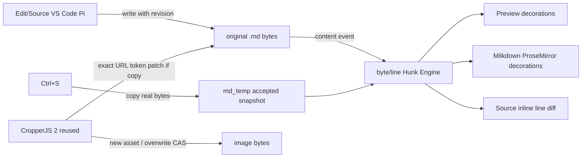

# Implementation Plan: Markdown Fidelity (DRAFT)
**Spec:** specs/003-markdown-fidelity/spec.md | **Parent:** specs/002-lantern-foundation | **Owner:** main
Tất cả bước dưới đây yêu cầu chủ sở hữu phê duyệt trước khi viết mã. Không cài package trong vòng Spec-Kit.

## Summary
Giữ file .md thật làm dữ liệu sửa; md_temp chỉ là snapshot. Thay đổi được theo dõi từ bất kỳ editor/bot nào bằng revision và file notification. Diff canonical ở mức byte/line, render độc lập vào Preview, Milkdown/ProseMirror và Source; không tự tạo văn bản sai do serializer. Nâng CropperJS đang có thành trải nghiệm hình nhúng trong cả Preview/Edit, không copy lại UI/encoder.

## Technical references cần kiểm chứng trước khi code
- ProseMirror DecorationSet/Decoration.widget/Decoration.inline: https://github.com/ProseMirror/website/blob/master/markdown/guide/view.md
- Milkdown Crepe features/ProseMirror hooks: https://milkdown.dev/docs/api/crepe
- CropperJS v2 image/selection change and transform events: https://github.com/fengyuanchen/cropperjs/blob/main/docs/api/cropper-image.md
- CodeMirror 6 merge/unified diff: tài liệu chính thức đang công bố `unifiedMergeView({original})` ở https://codemirror.net/docs/ref/#merge.unifiedMergeView. Không suy ra package đã ngừng bảo trì chỉ vì một repo phụ từng archive; vẫn phải xác minh phiên bản/package/IME/EOL/BOM trên FJP trước khi chọn.
- Markdown positional parsing: so sánh mdast/remark + GFM source ranges với renderer plugin.py hiện tại; không dựa vào regex/Nth occurrence khi sửa tham chiếu.
- Repo hiện có: `lantern/live_markdown.py` (CAS/md_temp), `tools/visual_markdown_entry.js` (DecorationSet, mountImageCrop), `static/markdown_visual_shell.js`, `static/markdown_paged_editor.js`, `tools/image_crop_entry.js`, `plugin.py`.

## Model / Contracts đề xuất (cần chứng minh)
- CanonicalDocument {raw_bytes, sha256, decode metadata: BOM/EOL, path}; không ngầm mở newline chuẩn hóa.
- Snapshot {accepted_revision, md_temp_bytes}; Accept (Ctrl+S) ghi đúng raw_bytes hiện hành vào md_temp, không thay file gốc.
- WritePatch {file_rev, start_byte, end_byte, expected_span_hash, replacement_bytes, origin}; kiểm tra CAS nguyên tệp và span, atomic write.
- DiffHunk {kind, original_byte_range, current_byte_range, evidence, optional mapped PM range}; source/visual/preview chỉ hiển thị, không tự làm Diff engine khác.
- ImageReference {doc_rev, exact_url_token_byte_range, source_raw, resolved_image_path, asset_rev}; ImageCrop {natural_pixel_rect, output_format, overwrite|save_copy}.
- FileChange {path, new_rev, origin}; từ local file watcher, bỏ qua echo qua revision, KHÔNG đổi tệp chỉ vì sự kiện watcher.

## Luồng dữ liệu

## Phase 0 — Feasibility before committing to a parser/dirty-segment strategy
1. Lấy corpus dữ liệu thực đã ẩn đường dẫn cá nhân: 1KB/100KB/500KB, 30-col, nested GFM, duplicate rows, comments, HTML, frontmatter, CJK/Unicode, UTF-8 BOM, CRLF/LF hỗn hợp, no-final-newline; kiểm tra unchanged regions bằng hash.
2. Đo Milkdown serialize round-trip theo từng feature; xác định tỷ lệ byte-stable vs semantically-stable vs lossy, và liệu có giữ được start/end offsets qua remark source-map đến PM node hay không.
3. So sánh 3 hướng: giữ full Markdown serializer nhưng chỉ cho phép source-safe changes; chính xác dirty-block/segment patch; hoặc dùng editor nguồn (CodeMirror 6) làm authoritative cho những vùng không round-trip. **Không chọn thuật toán mới trước khi E1–E4 PASS.**
4. Kiểm tra CodeMirror 6 merge view khả năng hiển thị diff inline trong Source mà không đổi EOL/BOM và không buộc copy toàn bộ document mỗi keypress.

## Phase 1 — Document Store / Diff / Change Events
5. Cố định hợp đồng .md+md_temp trên `lantern/live_markdown.py`; document owner phải bảo toàn byte ngoài vùng edit; accept/cas/undo trên hash, external writer tracking.
6. Viết FileChange observer (nếu nhu cầu live external được chứng minh) chỉ báo current path/revision, không tự ghi; chạy trên Windows/Linux; có debounce/batching cho file lớn và echo suppression.
7. Một DiffHunk Engine có byte+line span, nút hunk Accept/Undo làm lệnh store, không tự thay giao diện chỉ do DOM.

## Phase 2 — Ba mode
8. Source: đầu tiên proof CodeMirror merge/unified view + full key/IME/CRLF/BOM parity; sau đó thay nguồn diff list dưới bằng inline annotations/gutter trong đúng editor.
9. Visual: dùng DecorationSet/plugin đã có; chỉ map source hunk tới PM node khi proof deterministic, với duplicate words/tables; widget deletion không serialize; keep selection/undo. Dirty-span patch nếu Phase 0 PASS.
10. Preview: dùng chính hunks, không duplicate heuristic; block positions có chứng cứ; nếu không map, show non-positional status chứ không gán gần đúng.
11. Anchor bridge: mode switch giữ scroll/cursor; highlight vị trí chính xác 500ms, chỉnh layout sát trái với chat; hunk action không che bảng 30-col.
12. Paged: same store, same hunk semantics, no full-file normalization hoặc hunk ghost ghi vào dữ liệu.

## Phase 3 — Crop nhúng Markdown
13. Tách adapter chọn ảnh/nối tham chiếu khỏi UI CropperJS 2; giữ lại `mountImageCrop()`, `openCrop()` và encoder hiện có.
14. Preview image click tạo ImageReference có byte range và doc rev từ parser có chứng cứ; không dựa vào số thứ tự/Nth src.
15. Crop Save-copy: ghi asset + patch URL token đúng ảnh chọn bằng CAS; khi thất bại giữ nguyên nguồn và báo rõ asset chưa gắn; có quy trình dọn file tạo thừa sau xác nhận.
16. Crop Overwrite: asset CAS và cảnh báo khi asset được dùng chung; giao diện của standalone và Markdown chia cùng crop engine; GIF animation không bị tự flatten.
17. Pixel tests cho JPG/PNG/WebP/BMP, EXIF, scaling, zoom, full-frame crop; GIF static/animated test policy.

## Phase 4 — Verification / Release
18. Unit/contract suite, browser E2E Source/Visual/Preview/VS Code/2 tabs, crop source/preview, CJK, IME, 390px/mobile, performance large .md.
19. Rebase từ main mới trước khi dev và trước merge, chạy lại tests, review độc lập, release khi FND gate đã qua và user phê duyệt.

## Go/No-go
- Bất kỳ silent normalization ngoài vùng edit: STOP / chọn fallback trung thực.
- Byte range/crop reference chỉ đoán: STOP, không ghi file.
- Tập corpus làm hỏng parser, hồi quy Milkdown Editor: STOP.
- Bản nháp legacy không rõ trạng thái: chỉ báo, không tự migrate.
- Không triển khai security/policy trong đợt này.

## Điểm cần người dùng quyết
- Tier 2: đoạn visual sửa có thay đổi formatting nên hiển thị diff cục bộ và được phép chấp nhận hay chỉ cho phép Source? Mặc định đề xuất cảnh báo rõ tại đoạn, không tự đổi đoạn không sửa.
- GIF động: từ chối crop và giữ animation với thông báo rõ, trừ khi duyệt thuật toán crop theo frame.
