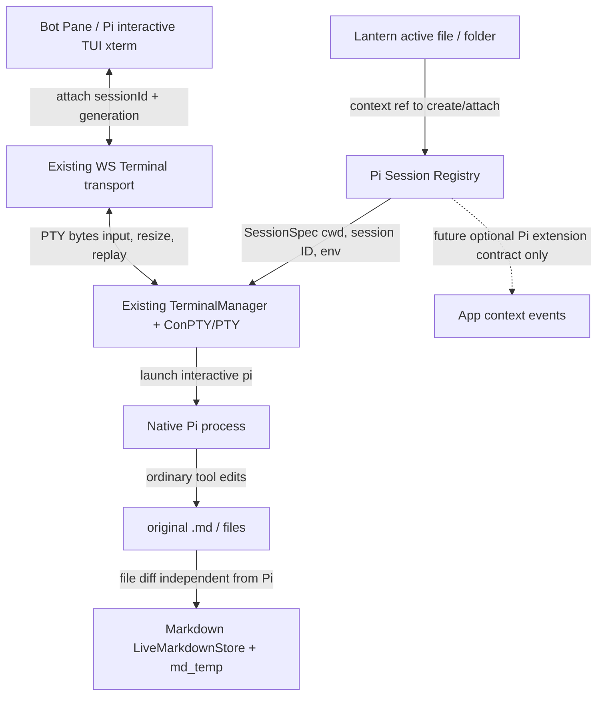

# Implementation Plan: Native Pi Harness in Lantern (DRAFT)
**Spec:** specs/004-pi-native-harness/spec.md
**Depends:** 002-foundation approved and merged. **Owner:** feat/lantern-bot.
**No implementation before user approval.**

## Summary
Thay chatbot RPC dựng HTML riêng bằng terminal Pi tương tác bản địa, chạy qua PTY/ConPTY và xterm.js/WebSocket mà Lantern đã có. Giao diện bot là shell/drawer có header, chọn session, mở rộng/fullscreen; thân nội dung hiển thị đúng Pi TUI. Mỗi sessionId là một Pi process/session file riêng, độc lập tab. Không xây observer JSONL hoặc lớp đối chiếu Markdown của bot.

## Mature references cần kiểm chứng
- Pi FJP `pi --help`: interactive /session-id, /session-dir, /tui-mode regular, model/provider selection, --tools, --no-extensions, --skill, --no-mcp. Cho chạy native, không wrap mọi prompt vào XML.
- Pi `docs/extensions.md`: UI methods custom TUI chỉ hoạt động đầy đủ trong interactive mode; RPC có nhiều no-op. https://app.unpkg.com/%40mariozechner/pi-coding-agent%400.68.0/files/docs/extensions.md
- Existing Lantern terminal: `lantern/terminal.py` (WinConPty), `lantern/ws.py`, `static/terminal_scm.js` (xterm.js), existing reconnect/replay/IME handling.
- Upstream xterm.js README (https://github.com/xtermjs/xterm.js) chính thức giới thiệu `@xterm/headless` + `@xterm/addon-serialize` cho khôi phục trạng thái terminal khi reconnect. Đây là ứng viên trưởng thành nếu replay buffer hiện tại không đáp ứng: phải thử thực tế ConPTY/modes/scrollback, không tự viết ANSI parser hoặc giả replay bằng resize-jiggle.

## Architecture

Không dùng Pi RPC cùng một session tương tác TUI; không chuyển transcript ra HTML thứ hai. Phiên B có context B từ lúc tạo; phiên A không bị retarget bởi B.

## Contracts (đề xuất, chứng minh trong spike)
- PiSessionSpec {sessionId: opaque UUID, cwd: absolute directory, contextRef: {kind, path, revision, optional selection}, sessionDir: Pi-native, argv/env}. sessionId không bằng path/tab id.
- PiSessionRegistry.create(spec), attach(sessionId, clientId, role), detach, takeoverWriter, list, reopenFromSessionFile, stop(sessionId), close().
- SessionView {sessionId, generation, owner, running, title, contextRef, cols, rows, acknowledgedSeq}; WS chỉ truyền scoped events theo attached session.
- TerminalSession.spawn(command + argv, cwd, env, cols/rows) từ TerminalManager hiện hành; PTY output buffered/screen state; không mở lớp song song.
- TUI input = native bytes từ xterm.js; không intercept /commands, không bọc XML chat prompt, không thêm CSS thay màu vào luồng output.
- Optional Future AppContextEvent {kind, path, revision, currentSelection, appAction} chỉ mô tả schema; không hiện thực event loop mới.

## Phase 0: Prove Pi parity on actual FJP
1. Trên một WORKTREE THỬ của feature sau duyệt, launch Pi TUI qua chính WinConPty hiện tại, không raw subprocess không PTY; thử /help, /model, picker, extensions, /goal, /new, /fork, Ctrl+C/Alt/IME/emoji, clipboard, paste image, multiline and resizing.
2. Characterize WS reconnect: attach lần đầu, F5, reconnect khi đang stream, two-viewer sizes, lossless cursor/modes/scrollback, generation id; không gửi lại terminal queries hay Enter. Nghiên cứu upstream xterm serializer/tmux-style screen owner trước khi chốt representation.
3. Nếu existing ring buffer không đủ, chứng minh replay bằng screen snapshot hoàn chỉnh hoặc chọn reference upstream phù hợp. Không triển khai custom ANSI renderer; không ship giả replay.

## Phase 1: Session ownership, one process per session
4. Session registry keyed opaque sessionId, metadata contextRef/CWD immutable theo lượt tạo, Pi-native session file duy nhất; Pi options mặc định đọc toàn bộ config global của Pi.
5. Tách việc xử lý nhiều browser tabs khỏi Pi process: một writer+size owner, nhiều viewers; explicit takeover, scoped WS generation/output. Browser close chỉ detach, không terminate process; host shutdown policy rõ.
6. Session picker: New Session (same path allowed), Attach Existing, Switch; từ file A chuyển B không retarget A, Bot pane mở lại tự attach session đang chọn.
7. Reopen Pi history sau Lantern restart dùng `--session`/sessionId theo Pi native; trạng thái interrupted không được trình bày là still running.

## Phase 2: Browser UI Native Pi
8. Render Pi TUI trong panel dùng existing xterm.js, fit addon; width có thể mở lớn/fullscreen vì TUI picker/tables. Không tái tạo danh mục model, slash commands, tool logs hoặc thinking.
9. Kiểm IME, alternate screen, mouse, UTF-8/ANSI, Ctrl/Shift+Enter, clipboard image, role resize. No custom onKeyDown intercept làm hỏng xterm unless measured.
10. File context: khi spawn truyền cwd/project path và Pi-native context channel đã chứng minh; tránh chạy agent với folder Lantern repo khi người dùng ở folder khác. Nếu đổi file, explicit new/switch context.

## Phase 3: Future hooks only
11. Mô tả hợp đồng typed AppAction/FileChanged cho chế độ maintenance tương lai, nhưng không cài observer, policy engine, auto action. Không import JS Markdown vào Pi runtime, không cần Pi gọi api_work.
12. LAN policy/model/tool/tokens chỉ đi vào design/decision table; **không triển khai**. Nếu không enforce được đúng, LAN Pi TUI không công bố trong đợt này; localhost full Pi parity.

## Phase 4: Acceptance
13. Golden parity against real Pi CLI trên FJP Windows; đa phiên/doc A/B, two-browser attach same session, reload/reconnect, /extensions UI, provider/new model tự hưởng update.
14. Test terminal thường + SCM + Markdown E2E để chắc Pi không gây degrade; latency/CPU/RSS và cổng chạy độc lập.
15. Rebase main mới trước phát triển và trước merge; review độc lập, ff merge chỉ theo phê duyệt.

## Stop/Release Gates
- Chưa chứng minh lossless snapshot/attach trên ConPTY: STOP.
- Tab B có thể Stop/retarget/model-change session A khi B không attach: STOP.
- Dùng HTML markdown để giả TUI hoặc /commands không chạy native: STOP.
- Cần sửa dữ liệu Markdown/legacy vì Pi: STOP, chuyển cho owner Markdown.
- Cần bảo mật mới để chạy LAN: không implement, yêu cầu quyết định scope riêng.
